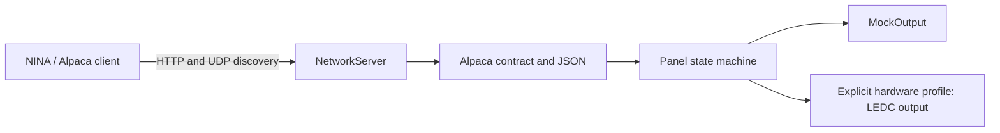

# Architecture

## Scope and decisions

The original [brief](PiriFlatMan-project-brief.md) is unchanged. Agreed requirements are native Alpaca over Wi-Fi, one calibrator, no cover motor, boot-off behavior, credential privacy and staged hardware validation. This milestone adopts the proposed PlatformIO/C++ architecture and chooses a 0–1000 logical brightness range. Board type, GPIO, PWM timing, electrical wiring and the original-code license remain unresolved. OTA, button behavior, browser provisioning and optical feedback are deferred proposals.

## Components



- `panel.h`, `panel.cpp`: connection transitions, brightness range, mapping, fail-off policy. No Wi-Fi, JSON or Arduino dependency.
- `alpaca.h`, `alpaca.cpp`: strict parameter parsing, dispatch, JSON envelopes, device metadata and HTML setup page. ArduinoJson is the only external library.
- `network.h`, `network.cpp`: shared nonblocking IPv4 socket adapter, incremental HTTP parser and UDP discovery. Compiles against POSIX sockets on Linux and lwIP sockets in ESP32 Arduino.
- `firmware.cpp`: Arduino entry points, Wi-Fi lifecycle, factory identity, NVS port storage and compile-gated LEDC adapter. Mock profile does not compile the panel GPIO/LEDC code.
- `host.cpp`: same panel, API and network implementation with a mock output. Its fixed host-only UniqueID is deliberately different from physical units.

All requests and panel mutations run on one loop. There are no callback threads modifying panel state and no locks. `Connect`/`Disconnect` enqueue completion for the next loop iteration. `Connected` PUT completes synchronously. LEDC/mock writes are short and complete before CalibratorOn/Off returns, so CalibratorChanging is false. A client may observe Connecting=true or may first poll after completion.

## Output and safety behavior

Boot starts disconnected, brightness 0, state Off (Error if adapter initialization fails). The hardware adapter sets the selected pin low before configuring a zero-duty LEDC channel. It checks ESP-IDF LEDC return codes, refuses connection after initialization failure, and stops the channel low on a write error. Errors report `0x500` and CalibratorState Error; Ready is never an optical measurement. A failed physical output cannot be proved off by software alone.

The panel remembers brightness only in RAM. There is no persisted brightness setting and no restoration path. Reset requires a new connection and illumination command. A passive pull-down and verified switching topology are still needed for ROM boot, reset and unpowered behavior; software cannot control those intervals.

The public logical range is 0–1000, independent of PWM resolution:

```
maximumDuty = 2^resolutionBits - 1
pwmDuty = floor((brightness * maximumDuty + 500) / 1000)
```

Intermediate arithmetic uses 64 bits. The hardware profile restricts resolution to 10–16 bits so each public brightness step remains distinct; mock uses a virtual 12-bit duty. Zero maps to zero, maximum maps to full duty, and there is no minimum-duty floor or gamma curve. Frequency is not selected until the switching stage is verified. A measured lookup table could replace the mapping later without changing the Alpaca range.

`CalibratorOn(0)` is Ready at zero duty. `CalibratorOff` is Off at zero duty. NINA's inspected ASCOM adapter accepts a minimum of zero and obtains MaxBrightness from the device; it uses brightness > 0 for its own LightOn presentation. That client convention does not alter the Alpaca state contract. See the [dependency/source review](dependencies.md).

## Connections and network recovery

Connection is a global logical attachment to the built-in output adapter. It is not an HTTP session or a per-client lease. ClientID does not acquire ownership, create reference counts or authenticate requests. Repeated connects/disconnects are accepted. A second client can read/control a connected panel; any client disconnect turns the light off for all clients. Coordinate multiple controllers outside the firmware.

The loop checks `WiFi.status()` each pass. On the first observed transition away from `WL_CONNECTED`, it forces light off, clears Connected and pending connection state, and closes all sockets. Association detection depends on the Wi-Fi stack and may lag physical radio loss. Losing a particular client while the ESP32 remains associated does not imply network loss and does not turn the light off. There is no HTTP inactivity timeout on illumination, so long exposures are not interrupted by a quiet client.

Association attempts run every 15 seconds without a wait-for-connection loop. HTTP/UDP bind failures retry every 5 seconds with output off. Recovery restarts sockets and requires a fresh logical connection and light command. No open AP is started. Millisecond deadline subtraction handles counter wrap. Missing/invalid local configuration leaves networking disabled and output off. The only loop delay is a 1 ms RTOS yield.

## Transport bounds

Four HTTP clients, one accept per loop, up to 1024 bytes read/written per client per loop, and one discovery datagram per loop bound each pass. Header limit: 4096 bytes; body limit: 2048 bytes; total per-client deadline: 5 seconds. Incomplete/slow clients expire without holding the panel loop. HTTP/1.0 and HTTP/1.1 use Content-Length and close the connection after one request; HTTP pipelining and chunked request bodies are rejected. `Expect: 100-continue` is supported. Alpaca's small GET/form PUT requests fit these limits.

There is no TLS, authentication, mDNS or IPv6 in this milestone. Discovery broadcasts require the same reachable broadcast domain and allowed UDP 32227; HTTP uses TCP 8080 by default. Host tests validate the shared implementation, not the ESP32 radio, lwIP timing, actual resets or GPIO behavior.

## Identity, configuration and timestamps

Physical UniqueID is `piriflatman-covercalibrator-` plus the 12 hex digits of the immutable 48-bit eFuse MAC returned by `ESP.getEfuseMac()`. It is independent of DHCP, Wi-Fi configuration, mutable station MAC, firmware version and flash/NVS contents. An NVS erase therefore does not change identity; replacing the ESP32 does. No identity write or flash wear is needed. Host mock identity is fixed for one local simulation only; do not deploy multiple host instances as distinct production devices.

Wi-Fi secrets and compile-time network settings live in ignored `config.local.h`. No Wi-Fi credentials are logged or rendered in HTML. The setup pages give status, a form for HTTP/discovery ports and instructions for changing Wi-Fi/IP settings in the local file. Ports are stored together as one atomic 32-bit NVS value and override compile-time defaults. A successful save forces output off and schedules a restart after one second; control writes are rejected during that interval. No brightness or credentials are stored in this NVS record. Returning ports to the defaults through the form, or erasing NVS, clears an unwanted port configuration; firmware updates normally preserve it. DHCP is default; optional static IP, gateway, subnet and DNS must all parse successfully. Router DHCP reservations are also supported operationally.

TimeStamp is omitted when UTC is unknown. An optional user-selected NTP server can provide UTC without blocking control. When synchronized, DeviceState includes an ISO 8601 UTC timestamp. No fabricated epoch/uptime is represented as wall-clock time. See the current official TimeStamp FAQ linked in the contract.
